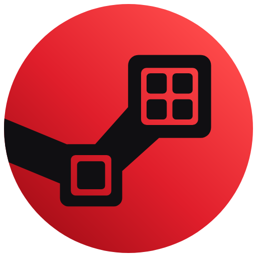
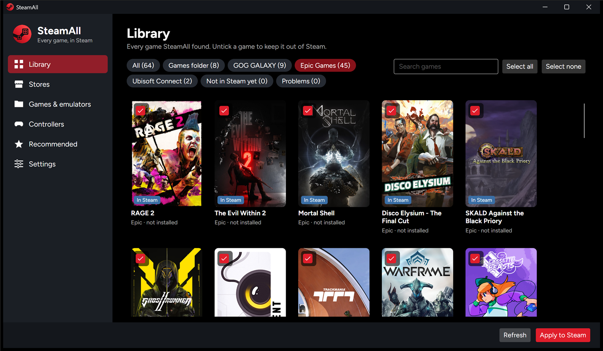
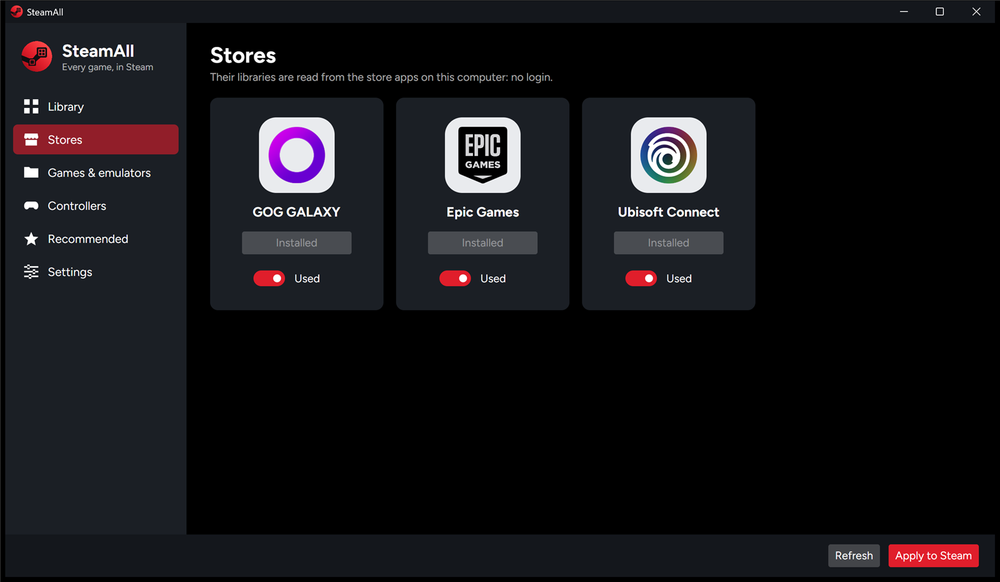
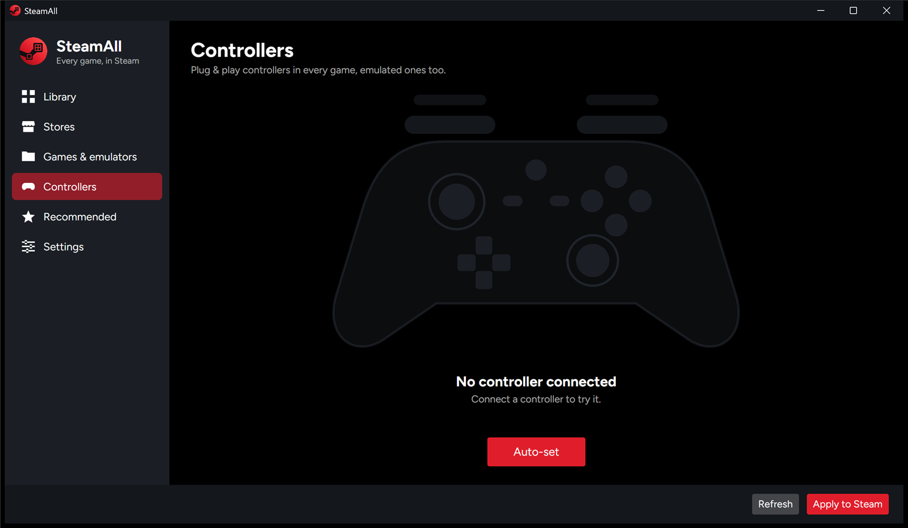
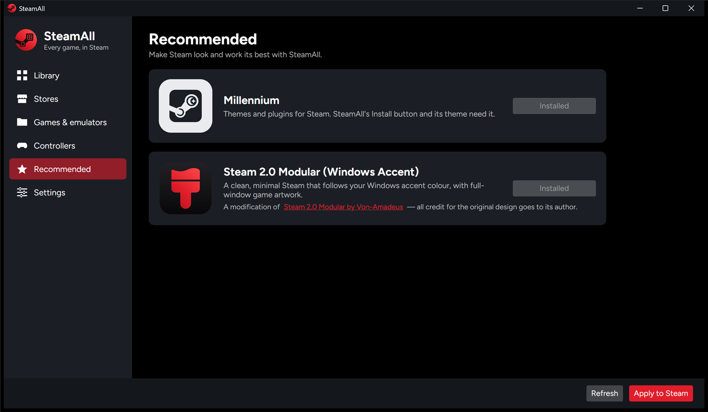

<p align="center">
  
</p>

<h1 align="center">SteamAll</h1>

<p align="center">
  <strong>Every game you own, in your Steam library.</strong><br>
  Free and open source.
</p>

<p align="center">
  <a href="../../releases/latest">Download</a> ·
  <a href="#getting-started">Getting started</a> ·
  <a href="#limits-today">Limits today</a> ·
  <a href="TODO.md">Roadmap</a> ·
  <a href="CONTRIBUTING.md">Contributing</a>
</p>



SteamAll makes Steam the one place for your whole game library. It adds your games from other stores, your game folders and your emulators to Steam, and goes one step further: the games you *own* on other stores but haven't installed show up too, as **not installed**, with an **Install** button that opens their store right on the game's page.

- **Stores**: GOG GALAXY, Epic Games and Ubisoft Connect (Windows). Their libraries are read from the store apps on your computer: **no login, no passwords**. Turn a store off and its games leave Steam. More stores are welcome: see *Adding a store*.
- **Game folders**: one folder per game, with a portable emulator inside (Ryujinx, Cemu, Dolphin, RPCS3) or a PC game, found automatically.
- **Installed emulators**: point SteamAll to an emulator and to your ROM folders. Each emulator takes only the games of its system, even if all your ROMs share one folder.
- **Plug & play controllers** for emulated games: started from Steam, any controller just works; outside Steam, your own setup is used.
- **Artwork**: covers, banners, heroes (HD 3840×1240 when available), logos and icons from [SteamGridDB](https://www.steamgriddb.com), falling back to the store's images.
- **A preview first**: a cover grid of everything SteamAll found, where you untick what you don't want. Nothing changes until you press **Apply to Steam**.

One file, nothing to install. Free and open source under the GPL-3.0.

<table>
  <tr>
    <td></td>
    <td></td>
    <td></td>
  </tr>
  <tr>
    <td align="center">Stores, read from your computer</td>
    <td align="center">Controllers and Steam Input</td>
    <td align="center">Millennium and the theme</td>
  </tr>
</table>

## SteamAll and BoilR

[BoilR](https://github.com/PhilipK/BoilR) adds the games installed from other stores to Steam, and SteamAll started as a replacement for it. The difference is what else ends up in Steam:

| | BoilR | SteamAll |
|---|---|---|
| Installed games from other stores | Yes | Yes |
| Games you own but haven't installed | No | Yes, with an Install button that opens the store |
| Emulators with ROM folders | No | Yes, each emulator takes only its own system's games |
| Portable emulator + game in one folder | No | Yes |
| Controllers in emulated games | Up to you | Set up automatically, in and out of Steam |
| Choose each game's artwork | Yes | Yes |
| Stores | Many | GOG GALAXY, Epic Games, Ubisoft Connect (for now) |
| Systems | Windows, Linux, macOS, Steam Deck | Windows (Linux and macOS builds not tested yet) |

If you only need installed games from a store SteamAll doesn't read yet, or you're on a Steam Deck, BoilR is the better choice today.

## Limits today

- **Three stores, on Windows**: GOG GALAXY, Epic Games and Ubisoft Connect. More are on the [roadmap](TODO.md), and pull requests are welcome.
- **Tested on Windows 11**, on the author's PC. The Linux and macOS builds are made automatically but haven't been run on real machines yet.
- **The Install button needs [Millennium](https://steambrew.app)** (a Steam client mod) and SteamAll's small plugin. Without them, games you haven't installed still work but show *Play*, which opens the store.
- **Automatic controller setup** covers Ryujinx, Cemu, Dolphin and RPCS3; the other emulators map controllers by themselves.
- **Apply closes Steam** while it updates the library, then starts it again.
- **Artwork needs a free [SteamGridDB](https://www.steamgriddb.com/profile/preferences/api) API key.**

---

## How it works

1. **Read.** SteamAll reads your Steam library (`shortcuts.vdf`), your game folders, your emulators' ROM folders and the stores on your computer. It never writes anything while it reads.
2. **Choose.** The **Library** page shows a cover for every game with its status:
   - **New**: will be added to Steam.
   - **In Steam**: already there, kept as it is (same app id, so artwork, collections and play time stay).
   - **Will be removed**: in Steam, but the game is gone, its store is turned off, or you unticked it.
   - **Skipped**: something is wrong (the tooltip says what), or the same game is already in Steam.

   Untick a game (its checkbox) or a whole game folder to keep it out. Click a cover to open the game's page: its logo, store and artwork; click an image to pick another one from SteamGridDB (it goes to Steam on the next Apply). Your choices are remembered.
3. **Apply.** **Apply to Steam** asks for confirmation, then:
   - writes the launchers of your emulated games;
   - downloads the missing artwork;
   - closes Steam right away, updates the library (keeping a backup, `shortcuts.vdf.steamall-backup`) and starts Steam again;
   - moves leftover artwork of removed games to the Recycle Bin.

Shortcuts you added to Steam by hand are never touched. Files are never deleted: they go to the Recycle Bin (the Trash on Linux and macOS).

### Stores

The **Stores** page lists the stores SteamAll knows, each marked **Installed** or **Not installed** (with a link to get it). Installed stores can be turned on or off:

- **On**: its games go to Steam. Installed games start with the store's own app (so licences, updates and cloud saves work as usual); games you own but haven't installed become **Install** shortcuts that open the store on the game's page.
- **Off**: its games are not imported, and those SteamAll (or BoilR) put in Steam before are removed on the next Apply, Install shortcuts included.

Every store opens its own app: nothing goes through GOG GALAXY, so Install on a Ubisoft game opens Ubisoft Connect directly. Only stores tested for real are included; on Linux and macOS there are none yet (game folders and emulators work everywhere).

#### Adding a store

A store is one class implementing `IStoreProvider` (`src/SteamAll.Core/Stores`: see `EpicStore`, `GogGalaxyStore`, `UbisoftStore`) and one line in `StoreCatalog.For`. It reads the store app's own files (no login), lists installed and owned games, and says how to start an installed one. Pull requests are welcome.

### Installed games only, or your whole library

The first time you open SteamAll it asks how you want to use it (you can change it in **Settings**):

- **Installed games only**: like BoilR, nothing else to install.
- **Your whole library**: also the games you own but haven't installed. Steam shows them as *Install* only with [Millennium](https://steambrew.app) and SteamAll's small plugin, which SteamAll carries inside and installs with one button.

### Not-installed store games and the Install button

They are shortcuts that open the store page of the game through the system's link opener (`rundll32 url.dll,FileProtocolHandler` on Windows, `xdg-open` on Linux), like clicking a link. Without anything else, Steam shows them with **Play**, which still opens the store.

With [Millennium](https://steambrew.app) installed in Steam, SteamAll adds its small plugin (first start, or **Settings → What SteamAll adds**). It shows these games greyed out, outside your installed games, with **Install**. Once you install a game from its store, the next **Apply** replaces the shortcut with the real game.

### Game folders

```
C:\Games\
  Kirby and the Forgotten Land\
    Ryujinx.exe              ← the emulator, with its original name (portable copy)
    games\Kirby ... .nsp     ← the game
  The Bells Arietta\
    The Bells Arietta.exe    ← a PC game: an exe named like the folder
```

Portable emulators: **Ryujinx** (Switch), **Cemu** (Wii U), **Dolphin** (GameCube/Wii), **RPCS3** (PS3). Use the official English title as the folder name: it is the name in Steam, and the one SteamGridDB searches for. On Linux a PC game is a program named like the folder (`Name`, `Name.sh`, `Name.AppImage` or `Name.x86_64`).

### Installed emulators

On **Games & emulators → Installed emulators**, add an emulator, choose its program and one or more ROM folders (subfolders are searched too). SteamAll recognises the emulator from its program and takes only the files of its system:

| Emulator | Games |
|---|---|
| Ryujinx (Switch) | `.nsp` `.xci` (base games only: updates and DLC are left out) |
| Cemu (Wii U) | `.wua` `.wux` `.wud` `.wuhb`, extracted games (`code\*.rpx`) |
| Dolphin (GameCube/Wii) | `.rvz` `.iso` `.gcm` `.wbfs` `.ciso` `.gcz` `.wia` `.wad` `.m3u` |
| RPCS3 (PS3) | disc folders (`PS3_GAME`) and installed digital games |
| PCSX2 (PS2) | `.iso` `.chd` `.cso` `.zso` `.gz` `.m3u` |
| DuckStation (PS1) | `.cue` `.chd` `.pbp` `.ecm` `.mds` `.m3u` |
| PPSSPP (PSP) | `.iso` `.cso` `.pbp` |
| melonDS (DS), Azahar (3DS), mGBA (GB/GBA), Xenia (Xbox 360) | their usual formats |

Formats shared by several systems (`.iso`, `.chd`, `.cso`, `.pbp`) are told apart from the file's content (the disc's signature) and from folder names such as `PS2` or `PSP`. Multi-disc games with an `.m3u` playlist appear once. Names come from the file names, cleaned up (`Super Mario Sunshine (USA) [!].rvz` → *Super Mario Sunshine*); PS3 and extracted Wii U games use the title inside the game. The launch arguments can be changed for each emulator (`{rom}` is the game file).

### Controllers

For emulated games, Steam starts a small launcher (on Linux and macOS, SteamAll itself with `--launch`). Before every start it puts the right controller setup in place:

- **from Steam** (with Steam Input on): the setup for Steam's virtual controller, so any pad you connect works;
- **outside Steam**: the setup you made yourself in the emulator.

Hold **Shift** while starting a game (Windows) to open its emulator without the game and change its settings. Ryujinx, Cemu, Dolphin and RPCS3 setups are switched automatically; the other emulators map any controller by themselves. The **Controllers** page shows the controller you connect (its buttons light up as you press them) and whether Steam Input is on for it; **Auto-set** prepares the controller of every emulated game and emulator.

---

## Getting started

1. Download SteamAll for your system from the [Releases](../../releases) page and start it. Nothing to install.
   - Windows 10 or 11, 64-bit: `SteamAll-windows-x64.exe`.
   - Linux, 64-bit: `SteamAll-linux-x64` (make it executable: `chmod +x SteamAll-linux-x64`).
   - macOS on Apple silicon: `SteamAll-macos-arm64` (make it executable, and allow it in System Settings → Privacy & Security the first time).
2. Choose **Installed games only** or **Your whole library** (then install Millennium and the Install button).
3. **Settings**: paste your SteamGridDB key. **Stores**: turn off the stores you don't want in Steam.
4. **Games & emulators**: add your game folders (default `C:\Games` on Windows) and your installed emulators with their ROM folders.
5. **Library**: untick what you don't want, then **Apply to Steam**.

SteamAll keeps its settings in `%APPDATA%\SteamAll` on Windows and `~/.config/SteamAll` on Linux and macOS (the SteamGridDB key is stored encrypted, never in plain text), the launchers of installed emulators and a cache of covers and icons in `%LOCALAPPDATA%\SteamAll` (Linux: `~/.local/share/SteamAll`; macOS: `~/Library/Application Support/SteamAll`). On Linux and macOS, emulated games start SteamAll itself: if you move SteamAll, press **Apply** again.

Coming from BoilR? SteamAll takes over its Steam shortcuts with the same app ids, so artwork and play time stay. It doesn't need BoilR.

### Recommended theme

**Steam 2.0 Modular (Windows Accent)** gives Steam a clean, minimal look whose colours follow your Windows accent colour, with full-window artwork on game pages. SteamAll carries it and installs it from **Recommended**. It is a modification of **[Steam 2.0 Modular](https://github.com/Br1Rol2/Steam2.0-modular) by Von-Amadeus** (inspired by GOG GALAXY 2.0): all credit for the original design goes to its author.

---

## Building from source

You need the [.NET 10 SDK](https://dotnet.microsoft.com/download). [Node.js](https://nodejs.org) is optional; it runs the plugin's tests.

```bash
dotnet build          # builds everything
dotnet test           # runs the tests (they never touch your real Steam)
dotnet run --project src/SteamAll.App
publish.cmd           # tests, then publish\SteamAll.exe and publish\linux\SteamAll (single files)
```

The macOS build is made by GitHub Actions on a Mac (`.github/workflows/release.yml`), because Apple requires programs to be signed.

| Folder | What it is |
|---|---|
| `src/SteamAll.Core` | The engine, no UI: Steam library (`shortcuts.vdf`), stores, game folders, ROM scanning, the plan, apply, artwork, launchers, controllers, Millennium plugin installer |
| `src/SteamAll.App` | The Avalonia app (MVVM): pages Library, Stores, Games & emulators, Controllers, Recommended, Settings |
| `src/SteamAll.Launcher` | The game launcher for Windows (.NET Framework 4.8, built into Windows: tiny and instant) |
| `src/SteamAll.MillenniumPlugin` | The Millennium plugin for the Install button (plain JavaScript) |
| `tests/` | xUnit tests (fake Steam, fake stores, fake ROM folders, fake SteamGridDB) and the plugin's Node.js tests |

The code comments are in Italian: the project was written while learning.

---

## Credits

- [BoilR](https://github.com/PhilipK/BoilR), the inspiration: SteamAll uses the same app id formula and artwork naming, so their shortcuts can be taken over.
- [Playnite](https://github.com/JosefNemec/PlayniteExtensions), whose open code documents how Ubisoft Connect keeps its library on disk.
- [Steam ROM Manager](https://github.com/SteamGridDB/steam-rom-manager) for the idea of emulators with ROM folders.
- [SteamGridDB](https://www.steamgriddb.com) for the artwork, [Millennium](https://steambrew.app) for the plugin system, [Avalonia](https://avaloniaui.net) for the UI.
- [Steam 2.0 Modular](https://github.com/Br1Rol2/Steam2.0-modular) by Von-Amadeus, the theme the recommended one is based on.
- [Figtree](https://github.com/erikdkennedy/figtree) by Erik Kennedy, the typeface (SIL Open Font License).

SteamAll is not affiliated with Valve, Steam, GOG, Epic Games, Ubisoft or any store. Steam and the Steam logo are trademarks of Valve Corporation.

## Contributing

Pull requests are welcome, above all for the stores that are still missing ([TODO.md](TODO.md)). Every pull request needs passing tests and, in its description, proof that it works: see [CONTRIBUTING.md](CONTRIBUTING.md). Please contribute here rather than keeping a separate fork, so everyone gets the improvements.

## License

Copyright © 2026 Mattia Domizio.

SteamAll is free software under the [GNU General Public License v3.0](LICENSE): you can use, study, share and change it. If you distribute a modified version, it must stay open source under the same license, keep the original copyright, and say what you changed. Please give it a different name and logo, so people know which one is the original.
